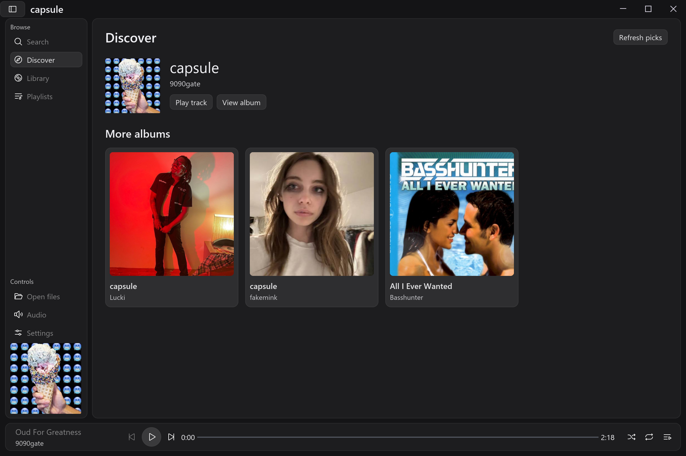

# Capsule

**All your music, in one place.**

Capsule is a music player built with Rust and Iced.

[Getting Started](#getting-started) ✦ [Preview](#preview) ✦ [Architecture](#architecture) ✦ [Philosophy](#philosophy) ✦ [Key Highlights](#keypoints) ✦ [Build Yourself](#build) 

## Preview 

## Getting started

Download and install the latest release from [releases](https://github.com/getcapsule/reimagined/releases) accordingly to your operating system.

## Build Yourself